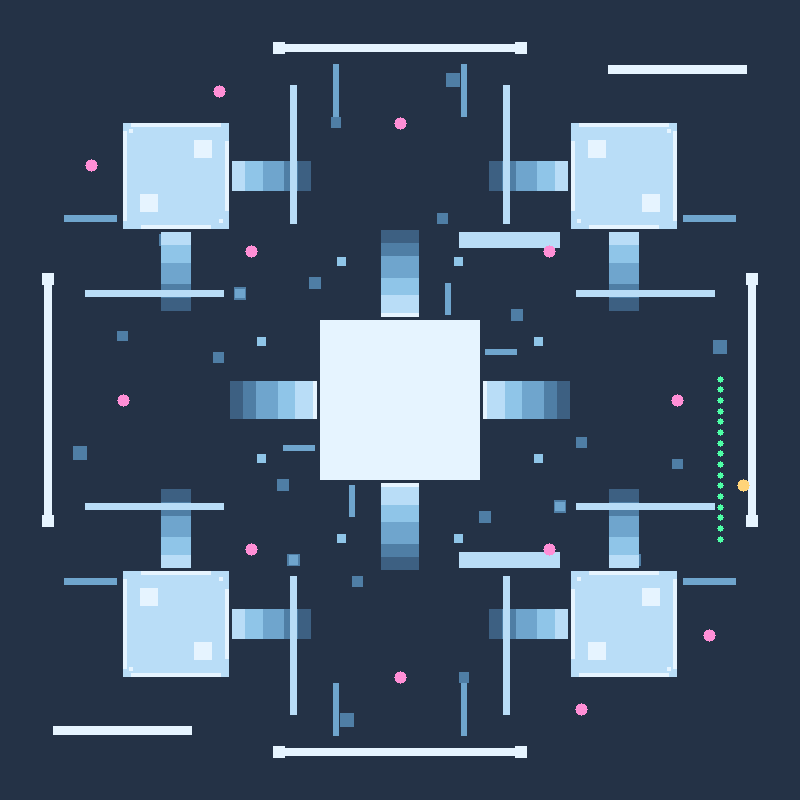

# SKYFALL

A LAN multiplayer 3D arena shooter that runs in the browser. One `npm start`
serves the game to every machine on your network — no install, no accounts, no
internet required.

```
███  S K Y F A L L  ███
```

Fight across a floating forest plateau thousands of metres above the clouds:
terraced hills, mossy rock ridges to wall run, woods and boulders for cover, a
shallow lake, two satellite islands — and, bolted onto the east gate, a smoking
industrial yard. A rock barrier ring keeps the fight in the arena; the void only
gets you if you jump off a bridge.

## The title screen

A rugged, grimy deployment screen — crest, dust, scanlines and a stencilled
SKYFALL wordmark on a smoking battlefield. Type a callsign, press **DEPLOY**,
or pick **PRACTICE** / **TUTORIAL**.

Two callsign rules:

* **"Big Joe" is reserved** — every variation of it (case, spacing, punctuation
  and leetspeak: `B1G_J0E`, `Big J0e`, `b i g j o e`) is locked unless you have
  the code. Try it without one and the game quietly renames you `PLAYER <id>`,
  on the client and on the server.
* **The code is `1013`** (a prefix of the callsign box or the code box — type it
  in that order). Entering it unlocks the crew skin: a glowing amber halo, a
  point light that lights up the terrain around you, and an emissive accent on
  the rig. Clear the badge to drop back to a normal skin.

## Quick start

```bash
npm install
npm start
```

The server prints the addresses it is reachable at:

```
  local   http://localhost:3000
  lan     http://192.168.1.42:3000
```

Open the **lan** address on any other device on the same network (phones/tablets
can spectate the menu, but the game needs a keyboard and mouse). Up to 10 players
can fight at once — first to nothing in particular, it's a free-for-all
deathmatch, so watch the scoreboard.

Change the port with `PORT=8080 npm start`.

## Weapons

| Weapon | Damage | Fire rate | Kill time | Notes |
| --- | --- | --- | --- | --- |
| **RIFLE** | 17 | 4 shots/sec (250 ms) | 6 shots to kill | 30 round mag, fully automatic |
| **SNIPER** | 100 | 1 shot every 3.5 s | one shot kill | 5 round mag, right-click to scope |
| **SMG** | 5 | 15 shots/sec (66.7 ms) | 20 shots to kill | 40 round mag, wide spread |
| **KNIFE** | 100 | 0.5 s swing cooldown | one shot kill | 2.7 m reach |

Fire rate is enforced **per weapon** on the server, so swapping guns can never
cheat a cooldown.

## Movement

Built to feel like **Titanfall 2**: fast, fluid, and entirely free of meters or
stamina. Speed is the resource — in the air you keep whatever you left the
ground with, and the trick is never to touch down flat.

* **Air speed is untouched.** No drag, no falloff. What you jump with is what
  you land with.
* **Air strafing** — hold forward + a strafe key and turn. Air acceleration only
  pushes you as far as `airWishSpeed` *along the wish direction*, so rotating
  your wish vector lets you carve past sprint speed. Holding forward alone will
  not turn you into a rocket.
* **Double jump** — one per airtime, costs ~13% of your horizontal speed plus a
  fixed upward kick. Refreshed by landing and by every wall kick.
* **Landing flat kills your speed** (capped at ~half sprint speed). Land in a
  **slide** and you keep 100% of it with a small boost — that is the skill.
* **Timed landing jump keeps everything.** Press jump as you touch down and
  your momentum is untouched — you also get a 2% nudge. The press may come up
  to 0.22 s *before* the floor (it waits for contact instead of burning your
  double jump) or up to 0.18 s *after* it. Press outside that and the landing
  penalty lands as usual. Holding jump is the auto-hop, not the timed jump: it
  bounces you but does not save the speed, so the timing is worth learning.
  A saved landing pops the speedometer amber instead of writing a word.
* **Wall running** carries your momentum and builds a little on top
  (about +1.2 m/s/s), lasts ~1.9 s, softens gravity, allows corner faces, and
  cannot be re-latched instantly onto the next panel. Kicking off a wall keeps
  your speed, refreshes the double jump, and pushes along the wall normal.
* **Mantling** — run into a ledge up to 1.45 m above your feet and you pull
  yourself over it instead of bouncing off.
* **You can always jump while sprinting.** Jump is checked before anything else
  and never loses your ground speed; **holding** jump keeps you hopping the
  moment you touch down, so a sprint-jump chain never eats an input.

| Move | Input | Notes |
| --- | --- | --- |
| **Sprint** | `Shift` + `WASD` | 10.2 m/s on the ground |
| **Sprint jump** | `Space` while sprinting | speed carries through the whole jump |
| **Auto-hop** | hold `Space` | hops again the instant you land |
| **Double jump** | `Space` again in mid-air | one per airtime, costs ~13% speed |
| **Air strafe** | forward + `A`/`D` while turning | the only way to go faster than sprint |
| **Wall run** | sprint along a wall and jump | ~1.9 s, soft gravity, no speed loss, latches even while rising |
| **Wall kick** | `Space` during a wall run | pushes off the wall, refreshes the double jump |
| **Slide** | `C` / `Ctrl` while sprinting, or while falling | fast, steerable, preserves momentum on landing |
| **Slide jump** | `Space` during a slide | keeps the slide speed in the air |
| **Timed landing jump** | `Space` on touchdown | 0.22 s early → 0.18 s late, keeps 100% |
| **Mantle** | run at a low ledge | automatic ledge grab |

Sprint is on by default when you hold `Shift`; jumping works at any speed.

The HUD carries **no movement labels** — just a speedometer bar and a number in
m/s, so you read your momentum off the bar. Tutorial objectives are the only
place moves are named, and they only appear in the tutorial.

## Practice & tutorial

Both run **offline in the browser** — no server, no sign-in, no other players.

* **Practice** — a live-fire range in the eastern meadow of the map: a
  30 m clear lane with six dummies at staggered ranges that respawn 1.6 s after
  you destroy them, an endless magazine economy, and a stats panel counting
  dummies downed, jumps, wall runs, slides and your top speed. The dummies
  **roam around their posts and shoot back — badly**: a 1.9 s telegraphed aim,
  ~17° of scatter, 3 damage a hit. If you hold still in the open they land about
  one shot in four; if you move they mostly miss, and going down just puts you
  back on the firing line.
* **Tutorial** — 15 objectives that teach the whole game in order: move, look,
  jump, sprint, sprint jump, double jump, wall run, wall kick, slide,
  carry speed (land in a slide), then rifle → sniper → knife → reload. Each step advances the moment you
  actually do the thing (the wall-run step teleports you to a wall and tells you
  where to run), and `N` skips a step if you get stuck. Finishing offers
  "keep practising" or back to the title.

## Leaderboard

Every kill and every death is folded into an **all-time table** that lives on
the server (`data/leaderboard.json`, override with `LEADERBOARD_FILE`) and
survives restarts. It shows on the title screen, comes down the wire with the
join handshake, is pushed again on every kill, and is also served as JSON:

```bash
curl http://localhost:3000/api/leaderboard?n=10
```

Rows carry **kills, deaths, K/D and best streak**, sorted by kills, then fewest
deaths, then streak. Joining is not enough to get on it — you appear once you
have a kill or a death to your name — so the table stays about combat. Names are folded case-insensitively — `Ghost`, `GHOST` and
`ghost` are one operator — and crew accounts (the `1013` code) get a ◆ marker
and the amber styling. In game, **`L`** opens the same table over your screen.

Because a LAN game has no accounts, a row belongs to whoever types that name;
only reserved callsigns ("Big Joe") go through a real check, which the server
enforces before anything reaches the board.

## Controls

| Input | Action |
| --- | --- |
| `WASD` | move |
| `Shift` | sprint |
| `Space` | jump · double jump · wall kick |
| `Left mouse` | fire (hold for automatic) |
| `Right mouse` | scope (sniper) |
| `1` `2` `3` `4` / mouse wheel | switch weapon |
| `Q` | previous weapon |
| `C` / `Ctrl` | slide (while sprinting) |
| `R` | reload |
| `Tab` | scoreboard |
| `L` | all-time leaderboard |
| `Esc` | pause menu (sensitivity, volume, FOV) |
| `M` | mute |
| `N` | skip a tutorial step |

## The map

One big floating forest, **240 × 240 m**, plus a **76 × 124 m industrial annex**
hanging off its eastern gate and two 150 m-away sky islands. 1,187 solid boxes,
129 hand-placed trees plus 135 boulders and about 7,000 instanced grass blades. It is all
generated from `shared/map.js` and merged into a single vertex-coloured mesh, so
the whole terrain is one draw call.

**You can no longer fall out of the world.** A 17 m rock barrier ring — nine
metres thick, with taller corner peaks — walls in the whole plateau. The only
ways past it are three deliberate gates: the industrial causeway to the east and
a bridge to each sky island in the north and south. The islands are ringed with
their own rock parapets and a single 4 m bridge gap, so stepping off the edge
means falling from the bridge, not wandering off a cliff.

* **Central hill** — a terraced, tree-ringed knoll 11 m tall with a flat crown,
  standing stones and a lone pine. Every terrace is under step height, so you can
  run up it from any direction.
* **Four mesas** in the corners, each with a lower shoulder sloping back toward
  the middle.
* **Nine rock ridges** — long mossy cliff walls (9–10 m) that are the map's
  wall-running highways, each with a ramp of boulders at one end.
* **Woods** — eight dense stands of trees with open meadow lanes between them.
  Trunks are solid: cover, and something to kick off.
* **Mounds and boulders** — 26 walkable knolls plus scattered rock clusters, so
  you are never more than a few metres from something to break a sightline.
* **Fallen logs**, **dirt trails**, **grass patches**, a **shallow lake** with an
  island, and an eroded, tree-fringed rim with rock shelves jutting into the void.
* **Two sky islands** 150 m out, reachable with a good wall kick or over the
  bridge, each ringed by a parapet with one bridge gap.
* **The industrial annex** (an addition, not a carve-out) — a fenced yard east of
  the gate with four sheds, six storage tanks, an overhead pipe run, a gantry,
  catwalks, two smoking chimneys and stacks of containers. Wide open in the
  middle: deliberately left as room for something very large.
* **19 spawn points**, each cleared of geometry and facing the middle.



`tests/map.test.mjs` asserts the plateau has no holes, every spawn is standing
room on the real surface, the hill and mesas can be walked up, the practice lane
is clear, and the wall-run staging spot produces a real wall run.

## How it works

* **Authoritative server** — `server/game.js` owns health, ammo, fire-rate
  limits, hit detection and respawns. Clients send their position at 20 Hz; the
  server rejects impossible movement (teleports), then finishes every shot's
  raycast itself, so you cannot fake a hit.
* **Client-side prediction** — movement, collision and the muzzle/tracer/hit
  feedback all happen instantly on your machine; the server has the final word
  on damage and kills.
* **One shared world** — `shared/map.js` describes the arena as a list of boxes
  and is imported by both the Node server (for collision/hitscan) and the
  browser (for rendering), so what you see is exactly what you can shoot.
* **Snapshot interpolation** — other players are rendered from 20 Hz snapshots
  with exponential smoothing, name plates and health bars above their heads.
* **Local modes** — practice and the tutorial reuse the exact same weapon,
  physics, HUD and rendering code as online play; only the damage/death handling
  is swapped for a local session object, so nothing can drift out of sync.
* **No assets** — every texture, model and sound is generated procedurally in
  the browser (Three.js primitives + WebAudio synthesis), so the whole game
  ships as source.

```
server/server.js      static file server + WebSocket lobby
server/game.js        authoritative match state, weapons, damage, respawns
server/leaderboard.js all-time table: ranking, streaks, JSON persistence
data/                 leaderboard.json (git-ignored, created on first kill)
shared/constants.js   weapon and movement balance
shared/map.js         240 m forest arena, spawns, practice markers
shared/collision.js   ray/AABB + ray/capsule maths used by server and client
public/index.html     title screen, HUD, menus
public/js/main.js     game loop, input, prediction, networking glue
public/js/world.js    terrain mesh, trees, grass, water, sky, clouds
public/js/physics.js  player movement and stair/ledge collision
public/js/viewmodel.js first-person weapon models and animation
public/js/avatars.js  remote player models and name plates
public/js/effects.js  tracers, sparks, blood, death rings
public/js/audio.js    synthesized weapons, footsteps and ambience
public/js/hud.js      DOM HUD, killfeed, scoreboard, death screen
public/js/practice.js offline practice range + the 15-step tutorial
public/vendor/three   Three.js (bundled so the game works offline)
```

## Deploying to Render

The server already binds `0.0.0.0` and reads `PORT`, so it runs unmodified on
Render (and any other Node host). A `render.yaml` blueprint is included.

**Blueprint (easiest):** Dashboard → **New +** → **Blueprint** → pick this repo →
Apply. That creates the service with the correct settings below.

**Manual web service:**

| Setting | Value |
| --- | --- |
| Language / Runtime | **Node** |
| Branch | `main` |
| Region | **Ohio** (or whatever is closest to your players) |
| Root Directory | *(leave empty)* |
| Build Command | `npm ci` |
| Start Command | `npm start` |
| Health Check Path | `/api/status` |
| Instance Type | **Free** (Starter removes the sleep) |
| Environment variable | `NODE_VERSION` = `22.22.3` |
| Instances | **1 — never scale up** |

Why instance count matters: matches live in server memory. Two instances means
two separate arenas and players who can't see each other. For the same reason
there's no sticky session to configure — just keep one instance.

WebSockets work out of the box on Render (the client automatically upgrades to
`wss://` on HTTPS). Things to know about the **Free** plan:

* It sleeps after ~15 minutes without traffic; the first visitor then waits
  ~50 seconds for a cold start. The Starter plan stays warm.
* Every deploy/restart drops all players back to the title screen. That's
  normal for in-memory matches.

## Cache safety

Every HTML/JS/CSS response is served `no-store` **and** stamped with a build id
computed from the newest source file: the page's asset URLs and every relative
import get `?v=<build>`, so a browser can never mix an old cached `main.js` with
a fresh `index.html` (that failure mode looks exactly like "the menu buttons do
nothing"). The build id is also shown in the bottom-right of the title screen and
sent as an `X-Skyfall-Build` header, and the client flags a mismatch on screen if
it ever sees one.

If a menu button ever seems dead, check the tag: `build <id> · forest v7`
means the current code is running. Press `Ctrl/Cmd + Shift + R` to force a fresh
load.

## Tests

```bash
npm test
```

121 checks across nine suites:

| Suite | Covers |
| --- | --- |
| `tests/game.test.mjs` | weapon damage, fire rates, cooldowns, hit detection, regen, respawn, anti-cheat |
| `tests/physics.test.mjs` | walking, stairs, walls, jumping, ledges, crates, plus the real arena (spawns, stairs, cover, void) |
| `tests/map.test.mjs` | map size and cover distribution, spawn clearance, walkable hills and mesas, practice lane and dummies, wall-run staging spot |
| `tests/movement.test.mjs` | air speed preservation, air-strafe gains, landing loss vs slide landing, double-jump cost, wall run speed/lifetime/corners/cooldown/wall kicks, mantling, jump-while-sprinting, auto-hop, slides, chained combos |
| `tests/leaderboard.test.mjs` | ranking, tie-breaks, K/D, streaks, name folding, crew flag, persistence round-trip, corrupt-file recovery, trimming |
| `tests/tutorial.test.mjs` | practice dummies, respawns, stats, and the full 15-step tutorial state machine |
| `tests/scene.test.mjs` | every 3D module built against real Three.js (no GPU needed) |
| `tests/ui.test.mjs` | the real `index.html` driven through jsdom: HUD, killfeed, scoreboard, input |
| `tests/browser.test.mjs` | the whole client boots in jsdom against a live server: deploy, move, shoot, swap guns, scope, reload, die, respawn, plus practice range, movement mechanics in-game, and tutorial completion |
| `tests/live.test.mjs` | HTTP + WebSocket protocol: joins, snapshots, firing, disconnects, malformed frames |

Plus `scripts/check-client.mjs`, a static audit of client import graphs and DOM ids.

## Notes

* Host firewall blocking the port? Allow Node (or the chosen port) on your LAN.
* Players only need a modern browser (Chrome, Edge, Firefox, Safari 16.4+) with
  WebGL. The mouse is captured by Pointer Lock; if a browser, iframe or embed
  denies it, the game switches to free-look automatically and never pauses
  itself over it.
* Health regenerates at 9 hp/s after 5 seconds out of combat. Respawns take 3
  seconds and always place you away from your killer.

MIT licensed.
